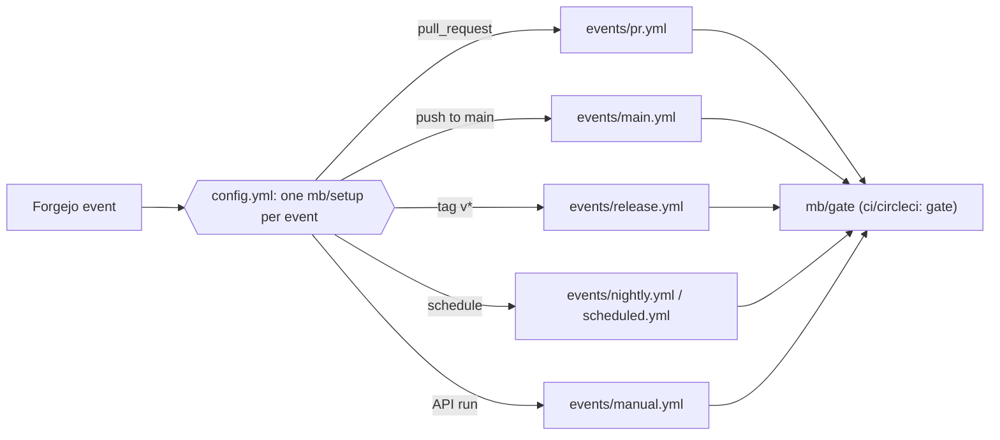
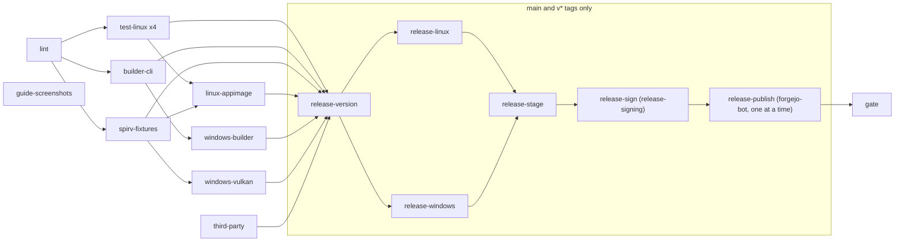
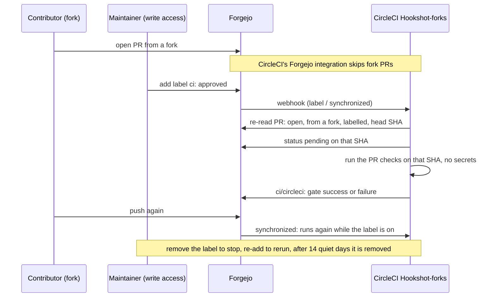

# CircleCI (Hookshot)

Continuation uses **`magicbeandev/ci@0.1.2`** (alias **`mb`**). Local validation inlines the packed orb from a checkout (`MB_ORB_DIR`); see below.

**PR title and description** are checked on **Forgejo** (`.forgejo/workflows/ci.yml`), not in CircleCI.

## How it flows



Each setup job compares the changed files with `mapping.conf` and only turns on the areas that changed (main, tags and API runs run everything).



`guide-screenshots` mirrors Forgejo's `guide-screenshots.yml` (the guide images and local UI source review, its two regression tests) and, like `lint` and `third-party`, runs on every PR and main push.

On a PR the release box is absent and `gate` waits for the checks. A red check on main stops the nightly before anything is signed.

### Fork pull requests

CircleCI does not build fork PRs from Forgejo, so a second CircleCI project (`Hookshot-forks`) on this same repo runs `.circleci/forks.yml`. It is started by a Forgejo webhook. Jobs that run fork code get no secrets; the doorbell, stale sweep and status-report jobs hold the bot token and run main's code and the orb.



## File map

| Path | Role |
|------|------|
| `.circleci/config.yml` | One `mb/setup` job per event (`pipeline.event.name` filters), plus `setup-noop` for non-continuing triggers |
| `.circleci/forks.yml` | Forks project: `mb/fork-doorbell` or `mb/fork-stale` |
| `.circleci/shared.yml` | Jobs, executors, Hookshot commands |
| `.circleci/events/*.yml` | Workflows per event; each ends at `mb/gate` (fork: `mb/fork-report`) |
| `.circleci/mapping.conf` | Path areas (`full`, `tests`, `gpu`, `linux`, `windows`, `website`) → pipeline booleans; `.circleci/`, `docs/tested*` also run the website jobs; `scripts/tools.py`, `nx2/third_party_objects.py` and `nx2/build.py` run both builders; docs-only changes turn on no area (lint, `third-party` and `guide-screenshots` always run) |
| `.circleci/test-suites.yml` | Smarter Testing `game-free checks` |

## Routing

| Trigger | Event | Notes |
|---------|-------|-------|
| `pull_request` (not `main`) | `pr.yml` | Path-filtered; website preview |
| `push` to **`main`** (no tag) | `main.yml` | CI + nightly release in one workflow (release after green checks) |
| Tag **`v*`** | `release.yml` | Core and Windows checks, then `mb/release-sign` / `mb/release-publish` |
| `schedule` + **`nightly`** | `nightly.yml` | Third-party upstream |
| `schedule` + **`website_refresh`** | `scheduled.yml` | Website deploy |
| `api` + manual flags | `manual.yml` | Release dry-run or Vulkan DLSS link |
| `api` + `full: true` only | `main.yml` (dry run) | Force-full main workflow via `setup-api-full` |
| `custom_webhook` (forks project) | `fork.yml` | `fork_pr` / `fork_sha`; doorbell sets **`full: true`** |
| Other tags, bare schedule/api | `setup-noop` in config | No continuation (e.g. `nightly-*` tags) |

## Tag: checks before release

On **`release.yml`**, `release-version` requires `lint`, `third-party`, `test-linux`, `builder-cli`, `spirv-fixtures`, `windows-builder` (the zip's PE and Wine checks, as `build-windows.yml`) and `windows-vulkan`, so nothing is built for release until the Windows checks pass.

## Main push: CI before nightly release

On **`main.yml`**, `release-version` requires the same check and builder jobs as production CI (`lint`, `third-party`, `test-linux`, `spirv-fixtures`, `linux-appimage`, `windows-builder`, `windows-vulkan`). Setup passes `nightly: true` on main so `release-version` can mint a nightly tag while `release_dry_run` keeps sign/publish/deploy dry until cutover. `mb/gate` posts as **`ci/circleci: gate`** (`name: gate` on `mb/gate`). PR `gate` does not require the preview comment job.

## Dry-run until cutover

Forgejo's `release.yml` and `website.yml` are still the live publisher and deployer. The main push, the `v*` tag and the hourly website refresh set `release_dry_run: true` in `config.yml`: `release-sign` signs with a throwaway key, `release-publish` stops after the notes, and `website-deploy` runs `wrangler deploy --dry-run`. Drop it from those two `extra-params` at cutover. The checks run for real either way.

`test-linux` runs on x86-64 (`ubuntu2404-large`), so checks that skip themselves off x86-64 (`test_fpx_sticky`, `test_spawn_emit`) run there; no separate x86 job is needed.

## Contexts

`release-signing`, `forgejo-bot`, `cloudflare-prod`, `forgejo-comment`.

## Local

```bash
mise run setup
mise run lint
mise run deps    # Linux headers/glslang for run_all
mise run test
mise run ci:smoke
export MB_ORB_DIR=/path/to/orb   # MagicBeanDev/orb checkout (https://git.magicbean.dev/MagicBeanDev/orb)
mise run validate
```

## Fork CI (forks CircleCI project)

Forgejo repo webhook (one per repo) → Hookshot-forks custom trigger (`.circleci/forks.yml`): **Pull request label** and **Pull request synchronized** (JSON).

Forgejo only lets people with write access add labels, so adding **`ci: approved`** is the approval. The doorbell re-reads the PR from the API (open, from a fork, labelled, head SHA matches refs/pull/N/head), posts pending, and continues with `events/fork.yml` (`fork_pr` / `fork_sha`, no secrets). The label is sticky: each new push runs again while it is on. An event for a SHA that already has a gate status is ignored, unless the label was re-added since. Remove the label to stop; re-add it to rerun. After 14 days with no push and no new approval, `mb/fork-stale` removes the label and comments once.

Daily schedule on the forks project passes **`stale_sweep: true`** → **`mb/fork-stale`** (`days: 14`, `forgejo-bot`).

## Linux test toolchain

Forgejo pins: `apt`, `scripts/fetch_commit.sh`, pip packages, glslang 16.6.0 x86_64 tarball; `test-linux` on x86_64. SPIR-V fixtures inline in `spirv-fixtures`. Preview: artifact + `sed` + `preview-url.txt`.

**Python 3.12+** comes from the distro (CI apt / dev install); mise **2026.11.3** matches orb `setup-mise` (per-arch tarball + sha256). Repo tools use mise lockfile backends (`github:`, `aqua:`), not `core:python`, so GitHub attestations stay on. Chunk sidecars are Ubuntu **22.04** (`dash` for install/gate: use `set -eu`, no `pipefail`; pip uses `--user`, not `--break-system-packages`). **`.chunk/config.json`** mirrors `test-deps-linux`, then `mise run lint` and `mise run test --strict`.
