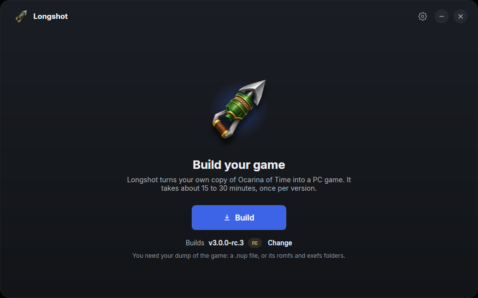
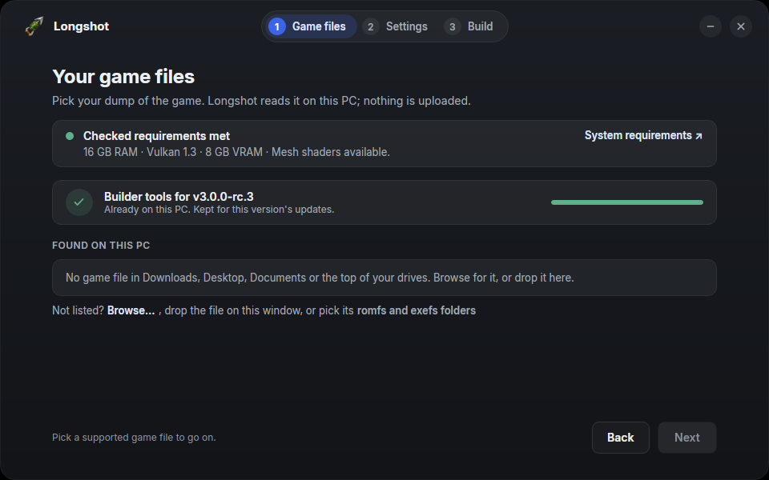

# Getting started

Hookshot is built on your PC, from your own copy of the game, by the Hookshot Launcher. It takes three steps.
**We do not host, store, or distribute game files, ROMs, game dumps, or decryption keys.**

## 1. Check your PC

Your copy of the game must be the supported version, and your PC needs a Vulkan 1.3 graphics card with 4 GB of video
memory (12 GB and mesh shaders recommended), 16 GB of system memory (32 GB recommended) and about 60 GB free while
building. See [what you need](../README.md#what-you-need).

The launcher checks your selected game files before the build. If it reports a different game build,
compare its message with the supported identifiers in the requirements above.

## 2. Download the launcher

- [Download for Windows](https://hookshot.magicbean.dev/download/launcher/windows)
- [Download for Linux](https://hookshot.magicbean.dev/download/launcher/linux)
- [Windows, portable zip](https://hookshot.magicbean.dev/download/launcher/windows-portable)

**Linux and SteamOS:** before opening the `.AppImage`, open its **Properties** in your file manager and enable
**Allow executing file as program** (the wording differs between desktops). Then open the launcher.
**On a Steam Deck,** read [Playing on the Steam Deck](steam-deck-playbook.md) before your first build: what the
build costs on the Deck, which two switches help, and the one clock setting worth knowing.

For the full setup instructions, follow [the Windows steps](../README.md#on-windows) or
[the Linux steps](../README.md#on-linux).

## 3. Build and play

Press **Build** on the launcher’s welcome screen.

*Launcher nightly-52-b1d9f7a9 on Linux, UI-only example. The selected game build is illustrative; your version may differ.*

On **Game files**, choose your game from the list. If it is not listed, use **Browse…**.
Choose **Next** once the launcher has checked your selection.

*Same Launcher example, with illustrative requirements and tools-ready results. Your PC is checked when you use the launcher.*

Follow the remaining launcher steps to build. Building takes about 15 minutes on a 12-core desktop, and longer on
a slower PC. Then press **Play**. The first start prepares the game's shaders, so it's slower than the next ones.

See [the in-game menu](../README.md#in-game-menu) for settings and controls. If something goes wrong, start with
[Common problems](common-issues.md) and [the README's troubleshooting](../README.md#if-something-goes-wrong).
